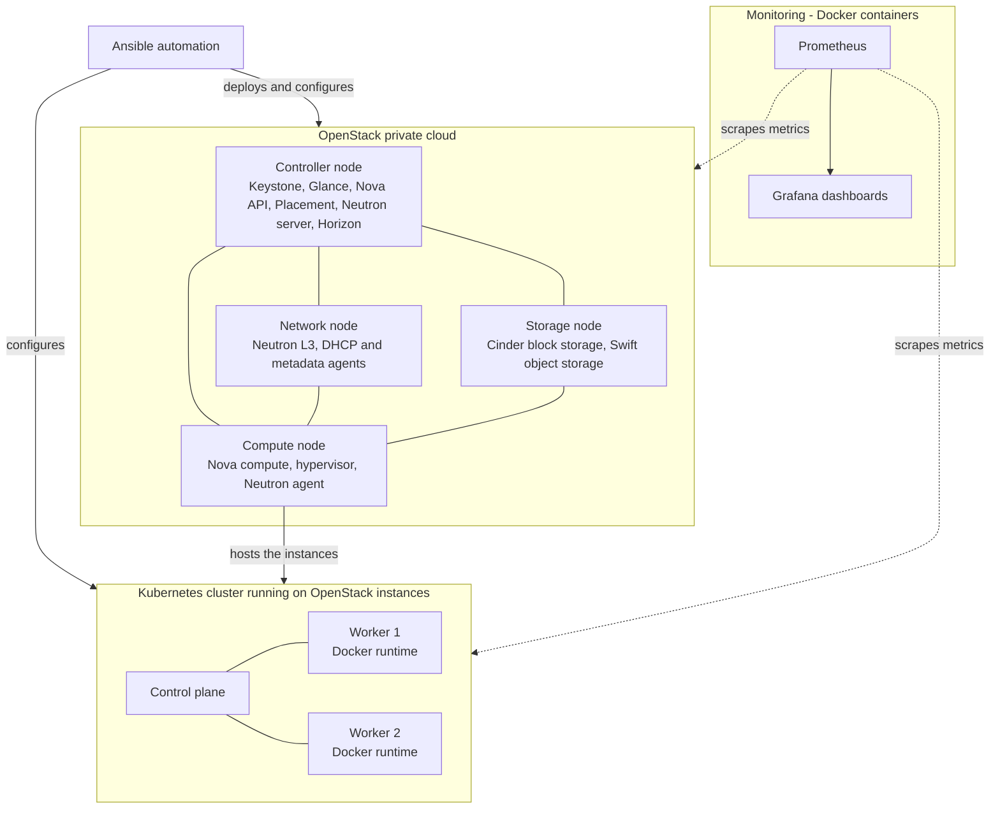

 

 

  

  

---

## 📖 Overview

Design and deployment of a **multi-node private cloud** on **OpenStack**, with **Docker**-based **Kubernetes** clusters running on top of it. The platform separates the cloud into dedicated **controller, network, compute and storage nodes**, automates instance provisioning and scaling, manages configuration with **Ansible**, and is monitored in real time with **Prometheus** and **Grafana**.

This was a **team project**. Each team member took ownership of a node role, and I was responsible for the **compute node**.

## 🏗️ Architecture

## 🖥️ Node roles

| Node | Responsibility | Main components |
|---|---|---|
| **Controller** | Control plane of the cloud: identity, APIs, scheduling, dashboard | Keystone, Glance, Nova API and scheduler, Placement, Neutron server, Horizon, database, message queue |
| **Network** | Virtual networking, routing, DHCP and external connectivity | Neutron L3 agent, DHCP agent, metadata agent, Open vSwitch / Linux bridge |
| **Compute** | Runs the virtual machines that host the Kubernetes nodes | Nova compute, KVM/QEMU hypervisor, Neutron agent |
| **Storage** | Persistent block and object storage | Cinder (volumes), Swift (objects) |

## 🧩 OpenStack services

| Service | Role |
|---|---|
| **Keystone** | Identity, authentication, authorization and service catalog |
| **Glance** | Image registry for virtual machine images |
| **Nova** | Instance lifecycle and scheduling across compute nodes |
| **Placement** | Resource inventory and allocation tracking for the scheduler |
| **Neutron** | Virtual networks, subnets, routers, security groups and floating IPs |
| **Cinder** | Persistent block storage volumes attached to instances |
| **Swift** | Scalable object storage |
| **Horizon** | Web dashboard to manage the cloud |

## 🐳 Containers and orchestration

- **Docker** is the container runtime on the Kubernetes nodes, packaging and running the workloads deployed on the cluster
- **Kubernetes** runs on OpenStack instances: a control plane and worker nodes provisioned on the compute node and configured with Ansible
- The **Prometheus and Grafana** monitoring stack runs as **Docker containers**, so it can be deployed and moved reproducibly
- Container images, cluster setup and monitoring deployment are all automated, so the full environment can be rebuilt from scratch

## 👤 My contribution: the compute node

- Deployed and configured the **compute node** that hosts the instances of the cloud
- Set up **Nova compute** with the **KVM/QEMU hypervisor** and connected it to the controller's Nova, Placement and message queue services
- Configured the **Neutron agent** on the node so instances attach to the virtual networks managed by the network node
- Integrated the compute node with **Glance** for images and **Cinder** for volumes, so instances boot from images and use persistent storage
- Prepared the instances that run **Docker** and **Kubernetes**, validating the path from image to running VM with networking, a volume and a working container runtime
- Automated the node configuration with **Ansible** so it can be rebuilt and scaled with additional compute nodes
- Exposed node metrics to **Prometheus** for monitoring in **Grafana**

## ✨ Platform highlights

- **Multi-node OpenStack cloud** split into controller, network, compute and storage roles
- **Automated provisioning and scaling** of instances for optimal resource utilization
- **Docker and Kubernetes** clusters deployed on OpenStack instances
- **Infrastructure as Code**: node, cluster and container configuration managed with Ansible playbooks
- **Observability**: real-time metrics and dashboards with Prometheus and Grafana

## 🔄 Workflow

1. Prepare the nodes, network segments and base operating system
2. Deploy the OpenStack core services on the controller node
3. Configure networking on the network node and virtualization on the compute node
4. Attach block and object storage through Cinder and Swift
5. Provision instances, install Docker and build the Kubernetes cluster on top
6. Automate configuration with Ansible and monitor everything with Prometheus and Grafana

## 🛠️ Tech stack

| Area | Technologies |
|---|---|
| Private cloud | OpenStack: Keystone, Glance, Nova, Placement, Neutron, Cinder, Swift, Horizon |
| Virtualization | KVM, QEMU |
| Containers | Docker |
| Orchestration | Kubernetes |
| Automation | Ansible |
| Monitoring | Prometheus, Grafana |
| Systems | Linux server administration |

## 🎯 Key takeaways

- Designing a private cloud with clearly separated controller, network, compute and storage roles
- Understanding how OpenStack services interact: identity, images, scheduling, networking and storage
- Running Docker and Kubernetes on top of an IaaS layer
- Teamwork on shared infrastructure with clear ownership per node
- Infrastructure as Code and observability for reproducible, monitored environments

---

### 👤 Author

**Mohamed Khelifi** · Cloud & DevOps Engineer

