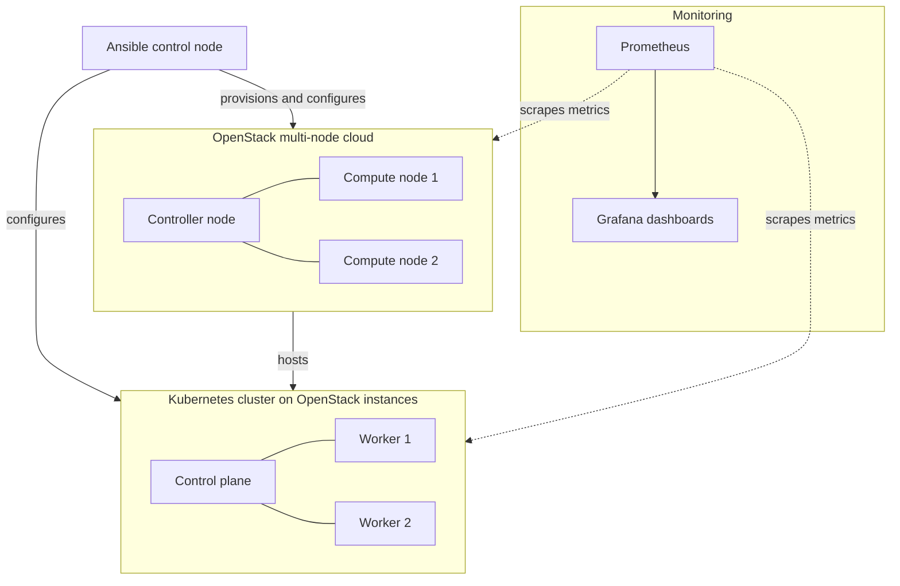

<div align="center">


<br>


<br>


<br><br>


<br><br>


</div>

---

## 📖 Overview

Design and deployment of a **multi-node private cloud** built on **OpenStack**, running **Kubernetes** clusters on top of it. Instance provisioning and scaling are automated to make optimal use of resources, cluster configuration is managed with **Ansible**, and the whole platform is observed in real time with **Prometheus** and **Grafana**.

## 🏗️ Architecture

> TODO: adjust this diagram to match your real topology (node roles, networks, number of nodes).



## ✨ What I built

- **Multi-node OpenStack cloud**: controller and compute nodes working together as one private cloud
- **Automated provisioning and scaling** of instances to use resources efficiently
- **Kubernetes clusters** deployed on top of the OpenStack instances
- **Configuration management with Ansible**: repeatable, idempotent setup of every cluster node
- **Real-time monitoring**: Prometheus collects metrics, Grafana visualizes them, giving full visibility into the infrastructure

## 🔄 Workflow

1. **Prepare** the nodes and networking
2. **Deploy OpenStack** across the controller and compute nodes
3. **Provision instances** automatically for the Kubernetes nodes
4. **Configure the clusters** with Ansible playbooks
5. **Monitor** everything with Prometheus and Grafana, and scale as needed

## 🛠️ Tech stack

| Area | Technologies |
|---|---|
| Private cloud | OpenStack |
| Orchestration | Kubernetes |
| Automation | Ansible |
| Monitoring | Prometheus, Grafana |
| Systems | Linux server administration |

> TODO: add what you actually used, e.g. the OpenStack deployment method and services (Nova, Neutron, Keystone, Glance, Horizon...), the Kubernetes distribution, the CNI plugin, the number of nodes.

## 🎯 Key takeaways

- Building and operating a private cloud from the ground up
- Infrastructure as Code with Ansible for reproducible environments
- Running Kubernetes on top of an IaaS layer
- Observability: metrics collection, dashboards and resource visibility

## 📂 Repository structure

> TODO: only keep this section if you publish the code. Example:

```text
.
├── ansible/          # playbooks and roles
├── openstack/        # deployment configuration
├── kubernetes/       # cluster manifests
├── monitoring/       # Prometheus and Grafana configuration
└── docs/             # screenshots and notes
```

## 📸 Screenshots

> TODO: add 2 or 3 screenshots (OpenStack dashboard, Grafana dashboard, `kubectl get nodes`). Put them in `docs/` and embed them like this:
> ``

---

<div align="center">

### 👤 Author

**Mohamed Khelifi** · Cloud & DevOps Engineer

[](https://linkedin.com/in/khelifimohamed)
[](https://hamoda73.github.io)
[](https://github.com/Hamoda73)


</div>
